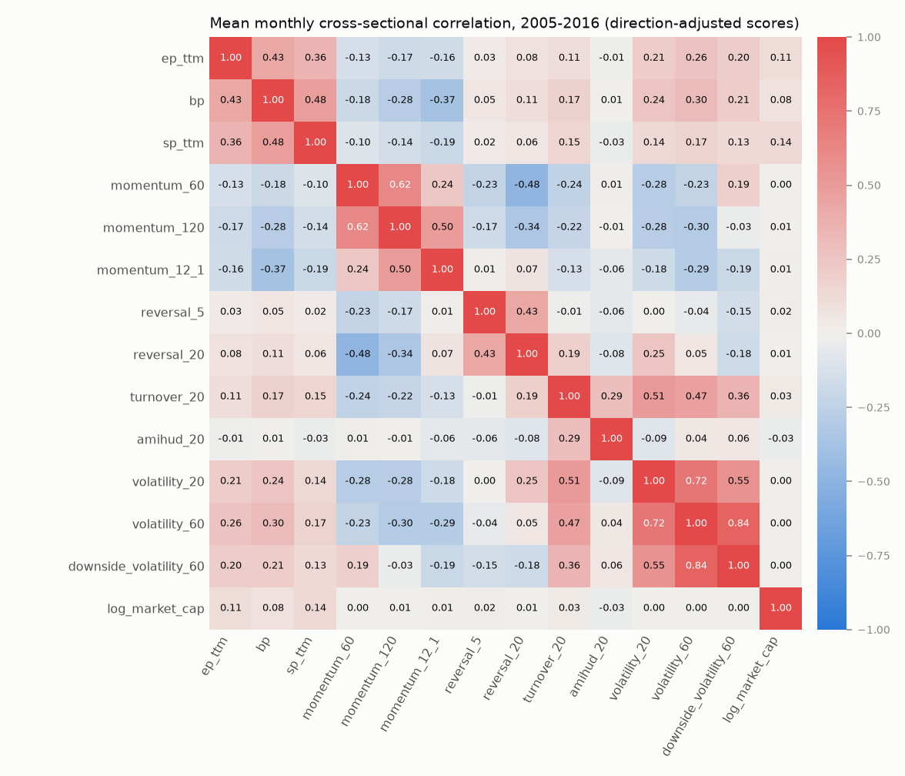
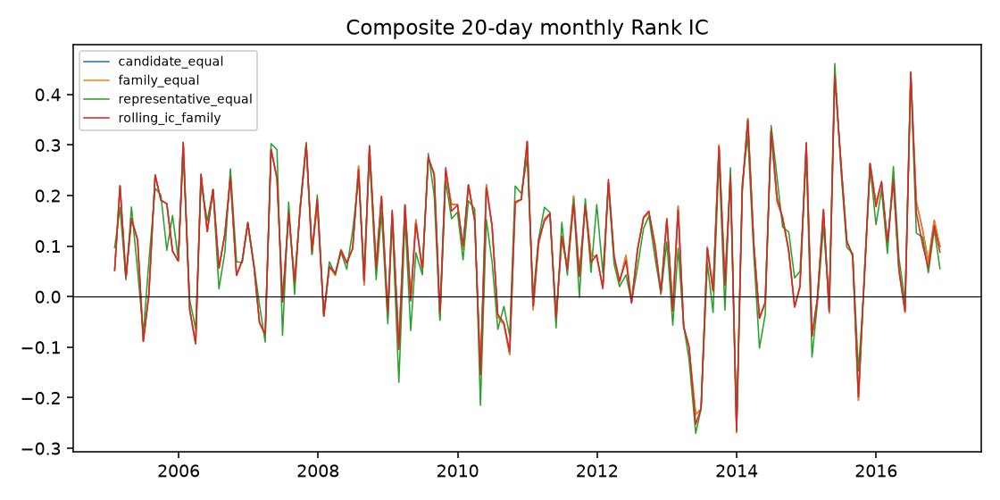
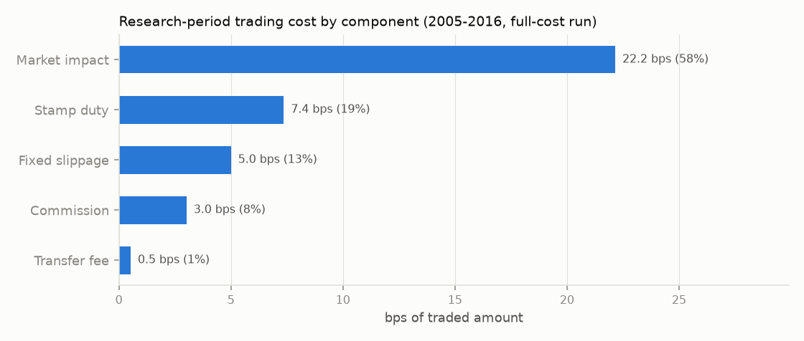
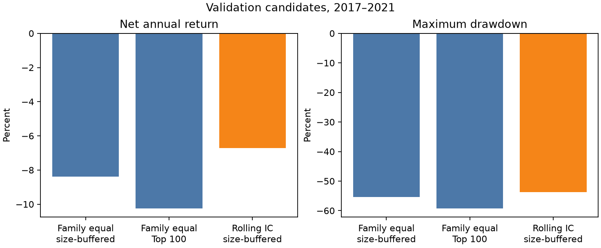
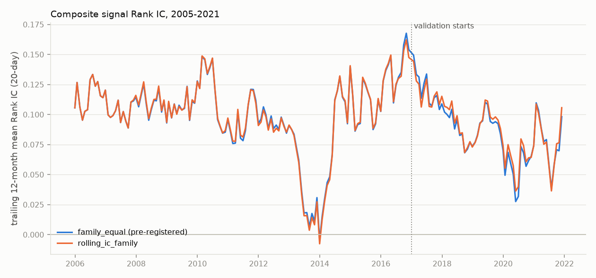
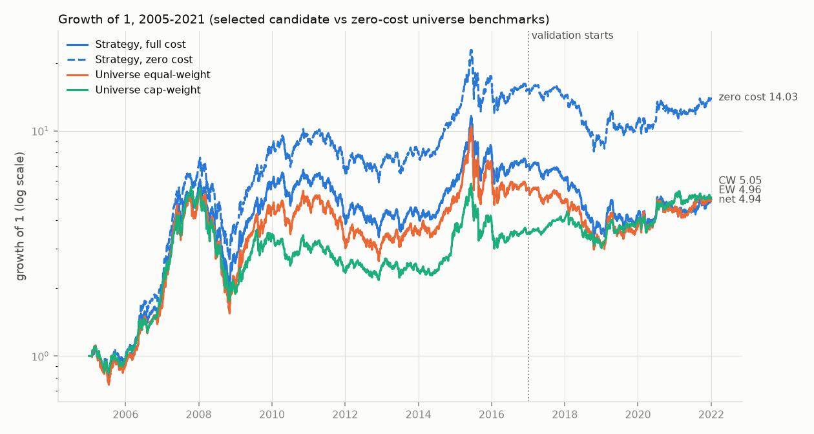
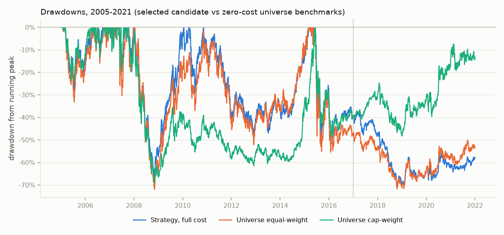
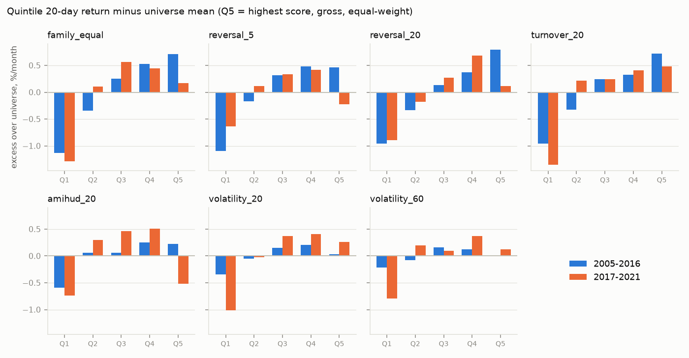
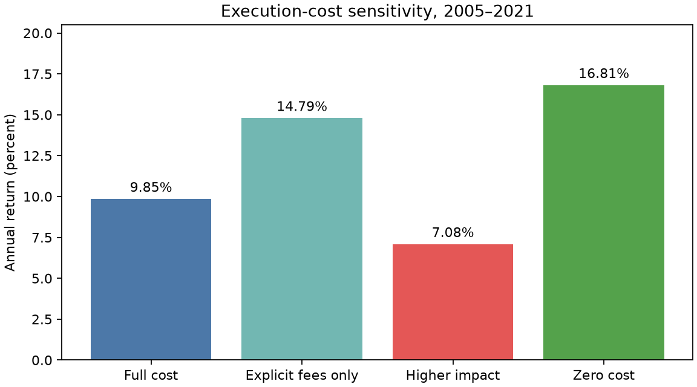

# A股横截面多因子研究与验证报告

## 摘要

本项目研究价值、动量、短期反转、流动性、低波动和规模因子在 A 股横截面中的预测能力，并将冻结的因子信号转化为包含真实交易摩擦的组合。研究按 2005–2016 研究期、2017–2021 验证期和 2022–2025 最终测试期分层；v1.0 只交付前两层，最终测试继续封存。

研究期中，14 个预注册因子形成 6 个 candidate、5 个 watch 和 3 个 reject。预注册 `family_equal` 复合方案的 20 日平均 Rank IC 为 0.102201。含完整成本的研究期执行回测年化收益为 17.6031%，但最大回撤达到 -66.9638%。独立验证期中，冻结规则选择滚动 IC、规模分层缓冲方案；其 Rank IC 为 0.0889、年化 ICIR 为 2.6349，净年化收益却为 -6.71%，最大回撤为 -53.78%。这说明截面排序能力没有稳定转化为扣除交易摩擦后的正组合收益。与同一股票池的零成本等权基准相比（第 7、8 节），验证期的负收益主要由股票池本身下跌和交易成本构成：选定方案零成本超额仅 0.426%，复合信号的多头腿已不显著，正的 Rank IC 主要来自空头腿。

该负面验证结果没有触发因子翻转、参数回改或最终测试开启。v1.0 的结论是：研究流程和审计链已经形成，部分因子在研究期和验证期保留截面相关性，但现有组合没有获得足以支持最终样本外有效性声明的证据。

## 1. 研究问题与样本

项目回答四个相互区分的问题：

1. 预注册因子是否具有可解释的截面预测关系；
2. 这种关系能否在独立验证期延续；
3. 信号在 T+1、整手、停牌、涨跌停、容量和成本约束下能否转化为组合收益；
4. 结果对成本、组合规则、因子删除和滚动窗口是否敏感。

固定样本如下：

| 用途 | 区间 | v1.0 状态 |
|---|---|---|
| 最长窗口预热 | 2003-01-01 至 2004-12-31 | 只形成历史窗口 |
| 研究期 | 2005-01-01 至 2016-12-31 | 完成 |
| 验证期 | 2017-01-01 至 2021-12-31 | 完成 |
| 最终测试期 | 2022-01-01 至 2025-12-31 | 继续封存，不报告策略结果 |

## 2. 数据、可得时间与偏差控制

研究与成交状态使用不复权日文件，总收益和跨期收益使用后复权日文件；二者按 `(date, symbol)` 一对一连接。证券代码保留六位字符串，历史股票池逐日生成，不使用今天仍上市的股票列表或未来退市时间回看历史。

关键时序约束包括：

- 股票池、因子和目标权重在 t 日只能使用 t 日及以前的信息；
- forward return 只作标签或评价结果，不进入特征、过滤或权重；
- 信号在 t 日收盘后形成，最早在下一真实交易日开盘执行；
- 滚动 IC 权重严格滞后一期；
- 最终测试期开启前冻结因子、组合、成本、评价指标和报告模板。

数据仍存在不可消除的来源限制：估值字段的历史 point-in-time 证据、历史行业口径和 ST 口径未完全核验。因此价值因子最多为 watch，阶段四不做行业中性化，稳健性中的行业结果只作限制性描述。

## 3. 单因子研究

阶段四在 2005–2016 研究期评价 14 个预注册因子，统一使用 Rank IC、年化 ICIR（月度 IC 均值 ÷ 标准差 × √12）、Newey–West 检验、FDR 校正、五分组、单调性、衰减、覆盖率、换手、子区间和冗余证据。

| 分类 | 因子 |
|---|---|
| candidate | `amihud_20`、`reversal_20`、`reversal_5`、`turnover_20`、`volatility_20`、`volatility_60` |
| watch | `bp`、`downside_volatility_60`、`ep_ttm`、`log_market_cap`、`sp_ttm` |
| reject | `momentum_120`、`momentum_12_1`、`momentum_60` |

三个动量因子均被拒绝，但研究没有据此事后翻转因子方向。candidate 表示通过预注册研究期门槛，不表示未来收益承诺。每个因子的定义、五分组、衰减、换手和子区间结果见[单因子卡片](../docs/factor_cards/README.md)。

### 3.1 动量为什么被拒绝：A 股中期是反转而不是动量

动量因子被拒绝，不是因为“没有信号”，而是因为信号方向与预注册方向相反。研究期 `momentum_60` 的平均 Rank IC 为 -0.0713（Newey–West t=-5.46），`momentum_120` 为 -0.0507（t=-3.98），`momentum_12_1` 为 -0.0217（t=-1.79）：过去涨得多的股票，此后反而倾向于跑输。

1. **预注册方向照搬了美股文献，事前判断有误。** 方向在看结果之前冻结为 +1；结果显著为负时，冻结规则要求拒绝而不是翻转。这正是预注册要防止的情况：如果看到负 IC 再把方向改成 −1，就等于用同一份样本选择了方向。
2. **负 IC 与已有 A 股研究一致。** Liu、Stambaugh 与 Yuan（2019，*Journal of Financial Economics* 134 卷，“Size and Value in China”）指出：与美国不同，中国市场不存在动量效应，而过去输家显著跑赢过去赢家的反转效应很强；他们也把换手率和反转列为中国市场的主要异象。这为本项目的反转、换手率因子提供了独立的文献依据。
3. **动量的信息已大部分被反转因子覆盖。** 方向调整后的 `momentum_60` 与 `reversal_20` 的月度平均截面相关为 -0.478，即“60 日动量”在相当程度上是“20 日反转”的反面。
4. **验证期继续成立。** 2017–2021 年 `momentum_60` 的 Rank IC 仍为 -0.0538（t=-3.21，自动滞后下 -3.50），且在下文的可成交口径下同样为负。

上图是研究期 14 个因子方向调整后得分的月度平均截面相关。60 日、120 日动量与反转因子负相关；三个低波动因子彼此高度相关，并与换手率正相关，说明它们捕捉的是相近的“高关注、高波动股票跑输”现象；规模与其余因子几乎不相关，因为它们都已做规模中性化。

如果后续版本要研究“中期反转”，它必须作为新的预注册因子，在尚未开启的最终测试期一次性检验，而不能用 2005–2021 的结果直接翻转动量方向。

### 3.2 可成交口径下的 IC

正式回测在信号日的下一交易日开盘成交，而 Rank IC 使用收盘到收盘的未来收益。这里把标签换成“下一交易日开盘买入、持有相同数量的有效交易日后按开盘价卖出”，检验 IC 是否依赖成交不到的隔夜价格。下一交易日不可交易的股票（停牌等）没有可成交标签，按收盘口径与可成交口径都有值的共同样本比较；研究期和验证期的共同样本覆盖率分别为 99.09% 和 99.85%，因此表中收盘口径的 IC 与已发布值略有差异。

| 对象 | 期限 | 研究期 收盘口径 | 研究期 可成交口径 | 保留比例 | 验证期 收盘口径 | 验证期 可成交口径 | 保留比例 |
|---|---:|---:|---:|---:|---:|---:|---:|
| `family_equal`（复合） | 20 日 | 0.102 | 0.0963 | 94.59% | 0.0857 | 0.0886 | 103.32% |
| `rolling_ic_family`（复合） | 20 日 | 0.101 | 0.0957 | 94.46% | 0.0890 | 0.0915 | 102.83% |
| `amihud_20`（因子） | 20 日 | 0.0305 | 0.0302 | 99.11% | 0.0175 | 0.0195 | 111.91% |
| `reversal_20`（因子） | 20 日 | 0.0769 | 0.0743 | 96.59% | 0.0549 | 0.0551 | 100.42% |
| `reversal_5`（因子） | 20 日 | 0.0661 | 0.0656 | 99.31% | 0.0162 | 0.0155 | 95.42% |
| `turnover_20`（因子） | 20 日 | 0.0824 | 0.0776 | 94.21% | 0.0766 | 0.0786 | 102.60% |
| `volatility_20`（因子） | 20 日 | 0.0515 | 0.0460 | 89.39% | 0.0781 | 0.0790 | 101.20% |
| `volatility_60`（因子） | 20 日 | 0.0463 | 0.0426 | 91.92% | 0.0679 | 0.0711 | 104.71% |
| `momentum_60`（因子） | 20 日 | -0.0710 | -0.0686 | 96.61% | -0.0538 | -0.0565 | 105.04% |
| `reversal_5`（因子） | 5 日 | 0.112 | 0.116 | 102.91% | 0.0353 | 0.0368 | 104.26% |

可成交口径几乎不改变结论：研究期复合信号保留约 95% 的 IC，验证期反而略有上升；即使是最依赖短期价格的 `reversal_5`（5 日期限），可成交口径下的 IC 也没有下降。因此，“IC 为正但组合没有超额”不是收盘价无法成交造成的，原因见第 7、8 节的基准与多空分解。可成交标签没有处理开盘涨停无法买入的情形，这部分由正式执行器负责。

### 3.3 Newey–West 滞后阶数的敏感性

单因子检验对 20 日标签使用滞后 0 的 Newey–West 标准误：月度采样下相邻标签几乎不重叠，但 IC 序列本身可能自相关。这里用 Newey 与 West（1994）的自动滞后规则 floor(4·(T/100)^(2/9)) 重算：研究期 T=143，滞后为 4；验证期 T=59，滞后为 3。BH 校正仍在 14 个因子的主口径上作为一个检验族进行，FDR 门槛不变。

| 对象 | t（滞后 0，原口径） | t（自动滞后 4） | FDR 门槛（滞后 0 → 自动滞后） |
|---|---:|---:|---|
| `family_equal`（复合） | 9.48 | 10.66 | 不参与 |
| `rolling_ic_family`（复合） | 9.44 | 10.51 | 不参与 |
| `amihud_20`（因子） | 3.85 | 3.90 | 通过（不变） |
| `bp`（因子） | 4.08 | 3.91 | 通过（不变） |
| `downside_volatility_60`（因子） | 0.891 | 1.05 | 不通过（不变） |
| `ep_ttm`（因子） | 4.82 | 4.59 | 通过（不变） |
| `log_market_cap`（因子） | 1.66 | 2.01 | 不通过 → 通过 |
| `momentum_120`（因子） | -3.98 | -4.12 | 通过（不变） |
| `momentum_12_1`（因子） | -1.79 | -1.78 | 通过（不变） |
| `momentum_60`（因子） | -5.46 | -5.33 | 通过（不变） |
| `reversal_20`（因子） | 6.42 | 7.08 | 通过（不变） |
| `reversal_5`（因子） | 6.71 | 7.03 | 通过（不变） |
| `sp_ttm`（因子） | 3.03 | 2.70 | 通过（不变） |
| `turnover_20`（因子） | 9.13 | 10.07 | 通过（不变） |
| `volatility_20`（因子） | 4.68 | 5.06 | 通过（不变） |
| `volatility_60`（因子） | 3.57 | 3.97 | 通过（不变） |

1. **主要结论不变。** 大部分 t 值在自动滞后下反而变大，说明月度 IC 序列整体不存在会夸大显著性的正自相关；复合信号的 t 值从 9.48 变为 10.66，验证期 `family_equal` 从 5.58 变为 5.95。
2. **唯一改变 FDR 判定的是 `log_market_cap`。** 它的 BH q 值从 0.104 降到 0.0512，在自动滞后下会通过 0.10 的门槛。按冻结规则，它仍是 watch，不追溯改为 candidate。值得注意的是，验证期该因子的 Rank IC 为 -0.101，方向完全反转；如果当初在研究期放宽统计口径把规模纳入合成，验证期会受到拖累。
3. 动量因子在两种滞后下都“通过”FDR，是因为检验是双侧的；它们因平均 IC 为负而被拒绝，与 FDR 无关。

### 3.4 控制其他因子后的增量信息：Fama–MacBeth 回归

Rank IC 一次只看一个因子，回答不了“控制其他因子之后，这个因子还剩多少信息”。这里在每个信号日做一次截面回归：用 20 日未来收益对截距和各因子得分回归，得分在回归样本内标准化，因此系数表示“其他因子不变时，该因子高一个截面标准差对应的 20 日收益溢价”。对月度系数序列取均值，并用与 Rank IC 相同的 Newey–West 口径检验（滞后 0，以及第 3.3 节的自动滞后）。得分是已发布的主分数变体，已做方向调整，系数为正表示与预注册方向一致。

回归设定在看系数之前固定为两组：进入合成的 6 个 candidate 因子，以及全部 14 个预注册因子。每月至少需要 100 只有完整数据的股票。

| candidate 六因子 | 研究期 溢价（%/月） | t（滞后 0） | t（自动滞后） | 验证期 溢价（%/月） | t（滞后 0） | t（自动滞后） |
|---|---:|---:|---:|---:|---:|---:|
| `amihud_20` | 0.201 | 2.55 | 2.16 | -0.415 | -3.01 | -2.90 |
| `reversal_20` | 0.187 | 1.24 | 1.22 | 0.0434 | 0.189 | 0.194 |
| `reversal_5` | 0.500 | 5.20 | 4.75 | 0.160 | 0.758 | 0.835 |
| `turnover_20` | 0.591 | 6.14 | 5.35 | 0.918 | 5.46 | 6.72 |
| `volatility_20` | 0.102 | 0.925 | 0.856 | -0.0735 | -0.324 | -0.297 |
| `volatility_60` | -0.154 | -1.06 | -1.03 | -0.0228 | -0.102 | -0.107 |

六因子回归的月均截面样本为研究期 999 只、验证期 1000 只，平均 R² 分别为 6.13% 和 5.89%。

1. **独立的增量信息集中在换手率和 5 日反转。** 研究期只有 `turnover_20`（t=6.14）和 `reversal_5`（t=5.20）在控制其他因子后仍然高度显著，`amihud_20` 较弱（t=2.55）。六个 candidate 各自的 Rank IC 都显著，但其中相当一部分是同一信息的重复。
2. **低波动因子被换手率吸收。** `volatility_20` 与 `volatility_60` 单独看时 t 值为 4.68 和 3.57（第 3.3 节），控制其他因子后降到 0.925 和 -1.06。这与第 3.1 节热力图中“低波动与换手率正相关”一致：它们捕捉的是同一类高关注、高换手股票的跑输。`reversal_20` 也类似，其信息大部分已在 `reversal_5` 和换手率中。
3. **验证期只剩换手率。** 2017–2021 年 `turnover_20` 的溢价为 0.918%/月（t=5.46），其余五个因子都不显著，`amihud_20` 显著为负（t=-3.01），与第 8 节其多头腿转负一致。也就是说，验证期复合信号的正 Rank IC 基本由换手率一个因子支撑。
4. **放入全部 14 个因子后结论不变。** `turnover_20` 的 t 值在研究期和验证期为 6.19 和 6.78，`reversal_5` 为 6.29 和 1.11；`momentum_60` 在研究期的系数为 0.181%/月（t=1.12），不再显著为负，印证第 3.1 节“60 日动量是 20 日反转的反面”。14 因子回归每月平均只有 884 只（研究期）和 905 只（验证期）股票数据完整，因为价值因子有缺失。

这些回归是事后加做的描述性检验，因子之间高度相关时单个系数不稳定，不能据此删减因子或重设权重。按冻结规则，六个 candidate 仍按因子族等权合成；若要改为“只用换手率和短期反转”，必须作为新的预注册方案在尚未开启的最终测试期检验。

## 4. 因子合成与目标组合

阶段五优先比较简单、可解释的组合：候选等权、因子族等权、代表因子等权和滚动历史 IC 加权。预注册主方案 `family_equal` 的 20 日平均 Rank IC 为 0.102201，年化 ICIR 为 2.735685。滚动 IC 方案没有显示足以替代简单基线的研究期优势，因此没有因复杂方法而改选。

规模分层缓冲组合平均单边目标换手为 67.9583%，低于 Top 100 等权基线的 76.2083%。目标权重只是执行器的事前输入，不是可成交收益结论。

## 5. 研究期正式执行回测

阶段六把冻结目标送入日线级开盘执行器。执行器处理 T+1、100 股整手、停牌、涨跌停、滞后 ADV 容量、佣金、最低佣金、分阶段印花税、滑点、冲击成本、未成交订单、公司行动、现金、持仓和应收款。

| 指标 | 完整成本结果 |
|---|---:|
| 总收益 | 598.3307% |
| 年化收益 | 17.6031% |
| 年化波动 | 30.2749% |
| Sharpe（零无风险利率） | 0.7079 |
| 最大回撤 | -66.9638% |
| 成交笔数 | 105,271 |
| 订单最终完全成交率（按订单笔数） | 49.43% |
| 买单最终未成交股数占比 | 3.72% |
| 卖单最终未成交股数占比 | 2.96% |
| 实际年化成交额/资产 | 16.11 倍 |
| 实现短缺率 | 0.3805% |
| 平均目标 L1 偏离（执行首日收盘） | 32.34% |

两项执行指标需要按口径解读：

- **订单完全成交率按笔数统计。** 一笔订单只有剩余数量为零才计为成交。买单在可用现金不足以覆盖全部目标时按比例缩量并向下取整到整手，剩余零头会一直挂到下一次信号被取消，因此大量订单“几乎成交”却不计入完全成交。阻塞原因中 `insufficient_cash_after_fees` 是最常见的一类，远多于涨跌停导致的阻塞。按股数计，买单和卖单最终未成交部分分别只占 3.72% 和 2.96%，49.43% 不能理解为约一半交易意图没有实现。
- **目标 L1 偏离是执行首日收盘时点的快照。** 它在每次新信号的第一个执行日收盘计算一次，包含受成交额参与率上限约束、需要多日完成的调仓，因此高于整个持有月的平均偏离。

市场冲击是最大的成本项，约 22.2 bps，占全部交易成本的 58.2%，超过印花税与佣金之和。成本主要来自成交量相对日均成交额的规模，而不是费率本身；因此降低换手或改善容量，比压低佣金更能减少成本侵蚀。

研究期结果具有高换手和深回撤。它证明的是执行和账务链能够审计，而不是策略已具备样本外有效性。三套账本最大逐日对账差为 0.00000024 元；长期陈旧估值另有停牌证据约束。

## 6. 独立验证期

2017–2021 验证期只比较三个冻结候选，不新增因子、不翻转方向、不修改执行参数。结果如下：

| 候选方案 | Rank IC | 年化 ICIR | 净年化收益 | 最大回撤 | 平均单边换手 | 成本侵蚀 |
|---|---:|---:|---:|---:|---:|---:|
| `family_equal_size_stratified_buffered` | 0.0855 | 2.4968 | -8.38% | -55.42% | 74.98% | 5.13% |
| `family_equal_top100_equal` | 0.0855 | 2.4968 | -10.24% | -59.22% | 84.88% | 5.55% |
| `rolling_ic_family_size_stratified_buffered` | 0.0889 | 2.6349 | -6.71% | -53.78% | 72.78% | 5.16% |

冻结规则选择 `rolling_ic_family_size_stratified_buffered`，因为它在相对收益、回撤和换手约束下通过预设门槛。三个候选的净年化收益仍全部为负，因此“被选择”不能解释为“验证期盈利”。

复合信号的 12 个月滚动 Rank IC 在 2005–2021 年基本保持为正，进入验证期后仍在零以上，但比研究期后段明显走低；两种合成方法几乎重合，这也是滚动 IC 加权没有带来实质差异的原因。滚动窗口在 2017 年初跨越研究期与验证期边界，只用于展示趋势。

## 7. 基准对比与超额收益

前文的组合指标都是绝对收益。只做多组合的绝对收益大部分来自市场整体涨跌，必须与基准比较才能判断因子是否创造了超额收益。这里构造两个**零成本**的股票池基准：每个信号日收盘按当期研究股票池（流动性前 1000 只、非 ST，与因子评价同一口径）等权或按总市值加权建仓，买入持有至下一个信号日收盘。基准只用信号日已知的成员和市值；停牌或退市的成员按最后收盘价持有到窗口结束。策略收益直接取自 Stage 6/7 已发布的 NAV，没有重新计算。

| 区间 | 股票池等权基准年化 | 股票池市值加权基准年化 |
|---|---:|---:|
| 研究期 2005–2016 | 15.24% | 10.98% |
| 验证期 2017–2021 | -1.97% | 7.71% |

| 组合 | 完整成本：相对等权超额年化 | 信息比率 | beta | 零成本：相对等权超额年化 | 信息比率 | beta |
|---|---:|---:|---:|---:|---:|---:|
| 研究期共同路径（2005–2016） | 2.05% | 0.0577 | 0.840 | 8.87% | 0.820 | 0.841 |
| `family_equal_size_stratified_buffered`（验证期） | -6.55% | -0.797 | 0.782 | -1.32% | -0.222 | 0.787 |
| `family_equal_top100_equal`（验证期） | -8.44% | -1.05 | 0.830 | -2.78% | -0.379 | 0.836 |
| `rolling_ic_family_size_stratified_buffered`（验证期，选定） | -4.84% | -0.604 | 0.786 | 0.426% | -0.0326 | 0.790 |

超额年化按几何方式计算，即策略与基准累计增长之比的年化值；信息比率和 beta 使用日收益。研究期超额年化为正但信息比率很低，原因是策略 beta 低于 1：在 2008、2011 等深跌年份少跌，几何复利的贡献大于日均超额。

| 年份 | 选定方案（完整成本） | 股票池等权 | 股票池市值加权 |
|---|---:|---:|---:|
| 2017 | -13.10% | -11.80% | 15.41% |
| 2018 | -41.96% | -36.53% | -23.86% |
| 2019 | 19.97% | 23.23% | 30.27% |
| 2020 | 6.58% | 18.89% | 24.71% |
| 2021 | 9.61% | 10.41% | 1.53% |

图中 2005–2016 段为三个候选共享的研究期路径，2017 年起为选定方案。

回撤图更直接地说明 beta 的作用：策略与等权股票池的回撤路径几乎同步，2008 年和 2018 年前后都跌去六到七成；市值加权基准在 2017 年后走出不同路径，对应同期的大盘风格。

由此得到三点：

1. **研究期的 17.6031% 年化收益大部分是市场 beta。** 同一股票池的等权基准年化为 15.24%；扣除成本后的超额只有 2.05%，信息比率 0.0577。零成本超额为 8.87%，说明信号本身有超额，但大部分被交易成本消耗。
2. **验证期的负收益有一部分来自股票池本身下跌。** 等权股票池年化 -1.97%，同期市值加权基准为 7.71%，即大盘股显著跑赢小盘股；规模分层等权组合天然偏向中小盘，处在不利的风格环境中。
3. **扣除市场后，验证期几乎没有毛超额。** 选定方案零成本相对等权基准的超额为 0.426%，信息比率 -0.0326；完整成本超额为 -4.84%。也就是说，验证期的负收益 ≈ 股票池下跌 + 交易成本，信号在只做多组合中没有留下可观的超额。

### 7.1 超额收益的置信区间

上表都是点估计。这里用循环分块 bootstrap 给出 95% 区间：把策略与等权基准的日收益**成对**按 21 个交易日一块有放回地重抽 10,000 次（固定随机种子），每次按与上表相同的定义重算年化收益、几何超额和 Sharpe。成对、分块重抽保留了两者的同日相关性和波动聚集。

| 组合 | 成本口径 | 年化收益 | 95% 区间 | 相对等权超额 | 95% 区间 | 超额 ≤ 0 的重抽占比 |
|---|---|---:|---|---:|---|---:|
| 研究期共同路径 | 完整成本 | 17.6% | [-3.18%, 42.7%] | 2.05% | [-3.36%, 7.94%] | 23.4% |
| 研究期共同路径 | 零成本 | 25.5% | [3.28%, 52.2%] | 8.87% | [3.07%, 15.2%] | 0.150% |
| `family_equal_size_stratified_buffered`（验证期） | 完整成本 | -8.38% | [-24.1%, 11.4%] | -6.55% | [-13.3%, 0.584%] | 96.5% |
| `family_equal_size_stratified_buffered`（验证期） | 零成本 | -3.26% | [-19.9%, 17.5%] | -1.32% | [-8.45%, 6.18%] | 63.8% |
| `family_equal_top100_equal`（验证期） | 完整成本 | -10.2% | [-26.4%, 10.0%] | -8.44% | [-14.7%, -1.84%] | 99.1% |
| `family_equal_top100_equal`（验证期） | 零成本 | -4.69% | [-21.9%, 16.9%] | -2.78% | [-9.39%, 4.23%] | 78.7% |
| `rolling_ic_family_size_stratified_buffered`（验证期，选定） | 完整成本 | -6.71% | [-22.8%, 13.5%] | -4.84% | [-11.5%, 2.24%] | 91.6% |
| `rolling_ic_family_size_stratified_buffered`（验证期，选定） | 零成本 | -1.55% | [-18.5%, 19.7%] | 0.426% | [-6.60%, 7.83%] | 45.5% |

1. **研究期扣成本后的超额在统计上不能与零区分。** 2.05% 的 95% 区间为 [-3.36%, 7.94%]，23.4% 的重抽样本超额不为正。零成本超额 8.87% 的区间 [3.07%, 15.2%] 不含零，说明信号本身有超额，被交易成本消耗到不显著。
2. **绝对收益的区间非常宽。** 研究期 17.6% 年化的区间为 [-3.18%, 42.7%]，Sharpe 0.708 的区间为 [0.0507, 1.41]；12 年的日线样本不足以把一个高波动只做多组合的收益估准，这是只看净值曲线容易忽略的。
3. **验证期没有任何方案显示正的超额。** 选定方案完整成本超额的区间为 [-11.5%, 2.24%]，零成本为 [-6.60%, 7.83%]；`family_equal_top100_equal` 的完整成本超额区间 [-14.7%, -1.84%] 整体在零以下。三个候选之间的差异远小于各自的区间宽度，因此“冻结规则选中滚动 IC 方案”不能解读为它显著优于另外两个。

区间限制：分块 bootstrap 假设收益序列平稳，无法反映样本外的制度变化；块长和重抽次数在计算前固定，没有按结果调整。

### 7.2 与公开指数的对比

股票池基准由本项目自己的数据构造，读者更熟悉的是公开指数。这里加入沪深 300（`sh.000300`）和中证 500（`sh.000905`）的日收盘点位，来自 BaoStock，只取到 2021-12-31。BaoStock 的指数数据从 2006 年开始，因此研究期的比较窗口是 2005 年最后一个交易日收盘至 2016 年底（11 年），比第 5 节的研究期少 2005 年一年；该窗口内策略完整成本年化为 20.1%，同窗口的股票池等权基准为 17.8%。验证期窗口与前文完全相同。指数的交易日与本项目日面板的交易日逐日一致。

| 区间 | 沪深 300 年化 | 中证 500 年化 | 股票池等权年化 |
|---|---:|---:|---:|
| 2006–2016 | 12.3% | 19.8% | 17.8% |
| 2017–2021 | 8.34% | 3.28% | -1.97% |

| 组合 | 成本口径 | 策略年化 | 相对沪深 300 超额 | 信息比率 | beta | 相对中证 500 超额 | 信息比率 | beta |
|---|---|---:|---:|---:|---:|---:|---:|---:|
| 研究期共同路径（2006–2016） | 完整成本 | 20.1% | 6.98% | 0.521 | 0.924 | 0.306% | -0.0812 | 0.883 |
| 研究期共同路径（2006–2016） | 零成本 | 28.1% | 14.1% | 1.00 | 0.926 | 6.95% | 0.726 | 0.885 |
| `family_equal_size_stratified_buffered`（验证期） | 完整成本 | -8.38% | -15.4% | -1.29 | 0.839 | -11.3% | -1.52 | 0.892 |
| `family_equal_size_stratified_buffered`（验证期） | 零成本 | -3.26% | -10.7% | -0.867 | 0.845 | -6.33% | -0.844 | 0.897 |
| `family_equal_top100_equal`（验证期） | 完整成本 | -10.2% | -17.2% | -1.35 | 0.869 | -13.1% | -1.73 | 0.942 |
| `family_equal_top100_equal`（验证期） | 零成本 | -4.69% | -12.0% | -0.904 | 0.875 | -7.72% | -0.996 | 0.948 |
| `rolling_ic_family_size_stratified_buffered`（验证期，选定） | 完整成本 | -6.71% | -13.9% | -1.15 | 0.844 | -9.67% | -1.30 | 0.898 |
| `rolling_ic_family_size_stratified_buffered`（验证期，选定） | 零成本 | -1.55% | -9.13% | -0.727 | 0.849 | -4.67% | -0.626 | 0.903 |

1. **研究期跑赢沪深 300，主要是中小盘风格，不是选股。** 完整成本下相对沪深 300 的超额为 6.98%，但相对中证 500 只有 0.306%，信息比率为 -0.0812；策略与中证 500 的日收益相关系数为 0.970，与沪深 300 为 0.893。也就是说，扣除成本后，这个组合在研究期的表现与直接持有中证 500 基本相同。
2. **验证期同时跑输两个指数。** 选定方案完整成本下相对沪深 300 的超额为 -13.9%，相对中证 500 为 -9.67%；即使不计成本，相对中证 500 仍为 -4.67%。
3. **验证期等权股票池本身大幅落后于指数。** 2017–2021 年沪深 300 年化 8.34%、中证 500 年化 3.28%，而流动性前 1000 只股票的等权组合为 -1.97%。等权持有千只股票比市值加权的指数更偏向小盘，这部分落后是股票池与加权方式带来的，第 7 节相对等权基准的 -4.84% 才是扣除这一因素后的结果。

指数对比的限制：两只指数都是**价格指数，不含分红**，而策略净值包含分红，因此上表的超额对策略偏有利，幅度约为指数的股息率（每年大致 1 到 2 个百分点，此处未精确计算）；指数不计交易成本；中证 500 在 2007 年才正式发布，此前的点位是指数公司回溯计算的。

基准限制：基准不计交易成本，因此完整成本超额对策略偏严；基准从信号日收盘建仓，策略在下一交易日开盘成交，两者相差一个隔夜区间；研究股票池不是可直接交易的指数。

## 8. 多头腿与空头腿分解

验证期 Rank IC 仍为正，但只做多组合没有超额。把五分组多空价差拆成两条腿可以解释这一点：**多头腿**为最高分组相对股票池均值的超额（只做多能拿到的部分），**空头腿**为股票池均值相对最低分组的超额（需要做空或至少回避才能拿到的部分）。收益使用与因子评价相同的 20 日未来收益（收盘到收盘、等权、未扣成本），按月计算后取均值；t 值与因子评价同口径（Newey–West，滞后 0）。

| 对象 | 区间 | 多头腿（%/月） | t | 空头腿（%/月） | t |
|---|---|---:|---:|---:|---:|
| `family_equal`（复合） | 研究期 | 0.707 | 4.13 | 1.13 | 5.17 |
| `family_equal`（复合） | 验证期 | 0.170 | 0.672 | 1.29 | 4.05 |
| `rolling_ic_family`（复合） | 研究期 | 0.671 | 3.91 | 1.14 | 5.17 |
| `rolling_ic_family`（复合） | 验证期 | 0.282 | 1.11 | 1.29 | 4.02 |
| `amihud_20`（因子） | 研究期 | 0.223 | 1.56 | 0.588 | 4.07 |
| `amihud_20`（因子） | 验证期 | -0.521 | -2.87 | 0.741 | 3.30 |
| `reversal_20`（因子） | 研究期 | 0.794 | 3.91 | 0.958 | 3.93 |
| `reversal_20`（因子） | 验证期 | 0.112 | 0.303 | 0.892 | 2.86 |
| `reversal_5`（因子） | 研究期 | 0.462 | 2.69 | 1.09 | 5.34 |
| `reversal_5`（因子） | 验证期 | -0.225 | -0.591 | 0.640 | 1.99 |
| `turnover_20`（因子） | 研究期 | 0.717 | 4.43 | 0.954 | 5.11 |
| `turnover_20`（因子） | 验证期 | 0.483 | 2.41 | 1.35 | 5.39 |
| `volatility_20`（因子） | 研究期 | 0.0354 | 0.191 | 0.344 | 1.70 |
| `volatility_20`（因子） | 验证期 | 0.260 | 0.968 | 1.02 | 3.08 |
| `volatility_60`（因子） | 研究期 | 0.00518 | 0.0255 | 0.216 | 0.964 |
| `volatility_60`（因子） | 验证期 | 0.127 | 0.428 | 0.791 | 2.26 |

五分组图把上表展开到全部分组：研究期（蓝）各信号大多呈从 Q1 到 Q5 的单调上升；验证期（橙）Q1 仍显著为负，但 `family_equal`、`reversal_20`、`reversal_5` 和 `amihud_20` 的 Q5 明显回落，单调性在顶部断裂。只做多组合买入的正是 Q5 一侧。

1. **复合信号的多头腿在验证期基本消失。** `family_equal` 的多头腿从研究期的 0.707%/月（t=4.13）降到验证期的 0.170%/月（t=0.672），空头腿则保持在 1.29%/月（t=4.05）。验证期正的 Rank IC 主要来自“避开最差股票”，A 股难以做空，只做多的 Top 组合拿不到这部分。
2. **低波动因子几乎只有空头腿。** 研究期 `volatility_60` 的多头腿仅 0.00518%/月，`volatility_20` 为 0.0354%/月，其 IC 来自高波动股票的显著跑输。
3. **`amihud_20` 在验证期多头腿显著为负**（-0.521%/月，t=-2.87）：最不流动的股票在 2017–2021 跑输股票池，与同期大盘风格一致。

这些分解只用于解释结果，不用于修改因子、方向或组合规则；若据此重新设计，必须作为新的预注册方案，在尚未开启的最终测试期一次性检验。

## 9. 稳健性分析

阶段八沿用验证期选定方案，在 2005–2021 范围内执行成本、组合、因子删除和滚动窗口敏感性分析，不再重新选模型。

各类实验实际改变的区间并不相同，解读时必须区分：

- **执行成本实验**（佣金、滑点、冲击、参与率、零成本等）在 2005–2021 全区间重跑执行器，变化覆盖全部 17 年。
- **组合、因子删除和滚动窗口实验**只重建 2017–2021 的目标权重；2005–2016 段所有变体共用同一份 Stage 5 研究期目标（`family_equal` 复合分数下的规模分层缓冲组合）。这些实验的 2005–2021 汇总指标中，约 12 年是完全相同的路径，变体之间的差异会被稀释，因此汇总指标会低估这些变体在 2017–2021 的实际影响，“稳定”判定偏宽松。
- **主方案本身也是拼接路径**：2005–2016 为 `family_equal` 目标，2017 年起才是滚动 IC 加权目标。
- **`market_size` 分段**只覆盖 2017–2021，计算的是股票池中小盘与大盘股票的平均未来收益，用于描述市场环境，不是策略或因子在大小盘中的表现。

汇总为 25 个稳定实验、9 个敏感实验，以及 2 个失败或未运行实验；其中组合、因子删除和滚动窗口类的“稳定”结论应按上述稀释效应保守解读。

### 9.1 只看验证期的对照

为消除上述稀释，这里把同一批预注册实验用未改动的 Stage 8 代码重跑一遍（每个实验的全区间指标都必须与已发布的 Stage 8 release 完全一致，否则整步失败），然后只在 2017–2021 切片上重算年化收益、最大回撤和年化换手，并套用同一组冻结容差（年化收益 ±2 个百分点、回撤加深不超过 5 个百分点、换手 ±0.15）。基线在该切片上的年化收益为 -6.71%、最大回撤 -53.8%、年化换手 8.62 倍，与 Stage 7 已发布的验证期结果一致。

| 实验 | 年化收益差：全区间汇总 | 年化收益差：只看验证期 | 最大回撤差（验证期） | 换手差（验证期） | 原判定 | 验证期判定 |
|---|---:|---:|---:|---:|---|---|
| `portfolio_buffer_high` | 0.0840% | 0.243% | 0.283% | -0.644 | 敏感 | 敏感 |
| `portfolio_buffer_low` | -0.481% | -1.38% | -2.05% | 0.755 | 敏感 | 敏感 |
| `portfolio_rebalance_bimonthly` | 1.65% | 4.85% | 4.48% | -3.79 | 敏感 | 敏感 |
| `portfolio_size_high` | 0.0257% | 0.0742% | 0.320% | 0.0216 | 稳定 | 稳定 |
| `portfolio_size_low` | -0.191% | -0.550% | -1.37% | -0.0988 | 稳定 | 稳定 |
| `portfolio_universe_low` | 0.957% | 2.79% | 4.55% | -0.899 | 敏感 | 敏感 |
| `factor_ablation_liquidity` | -0.249% | -0.717% | -0.901% | -0.389 | 稳定 | 敏感 |
| `factor_ablation_low_volatility` | -1.16% | -3.32% | -0.649% | 1.15 | 敏感 | 敏感 |
| `factor_ablation_reversal` | 0.192% | 0.555% | 4.46% | -1.14 | 敏感 | 敏感 |
| `rolling_window_high` | -0.0539% | -0.156% | 0.131% | 0.0425 | 稳定 | 稳定 |
| `rolling_window_low` | -0.0180% | -0.0521% | -0.340% | 0.0219 | 稳定 | 稳定 |

1. **稀释约为三倍。** 这 11 个实验在验证期的年化收益差大约是全区间汇总的 2.9 倍，与“17 年中只有 5 年不同”一致。例如隔月调仓在全区间汇总中只高 1.65%，只看验证期则高 4.85%，同时换手从 8.62 倍降到不足 5 倍；去掉低波动因子族在验证期低 3.32%。
2. **判定只有两处变化，结论整体成立。** `factor_ablation_liquidity` 由稳定变为敏感，原因是验证期换手下降 0.389，超过容差，而不是收益变化；执行成本类中的 `execution_impact_high` 由敏感变为稳定（验证期收益差 -1.84%，全区间为 -2.77%），因为冲击成本的影响随 17 年复利累计。其余 23 个可运行实验的判定不变，原先“稳定”的组合规模和滚动窗口实验在验证期内依然稳定。
3. **验证期内更好的变体不能事后采用。** 隔月调仓和较小股票池在 2017–2021 的收益更高，主要来自换手和成本下降；但它们是看过验证期结果之后才比较的，按冻结规则不改变主方案。若要采用，必须作为新的预注册方案在尚未开启的最终测试期检验。

该对照是描述性补充，冻结的 Stage 8 release 及其“25 个稳定、9 个敏感”的计数不因此改变。

成本情景的年化收益如下：

| 情景 | 年化收益 | 相对完整成本基线 |
|---|---:|---:|
| 完整成本 | 9.8467% | 0.0000% |
| 仅显性费用 | 14.7924% | +4.9457% |
| 更高冲击 | 7.0811% | -2.7656% |
| 零成本 | 16.8064% | +6.9597% |

结果表明成本与冲击假设对收益有实质影响。`portfolio_universe_high` 因请求股票池超过冻结上游而未运行；`regime_pre_registered` 因历史行业 point-in-time 未核验而只作描述。这些失败状态被保留，没有用替代实验补成全绿。

## 10. 研究解释

本研究支持三个有限结论：

1. 部分流动性、反转和低波动信号在研究期达到预注册截面门槛，并在验证期保留正 Rank IC；换成可成交的开盘到开盘标签、或采用更保守的 Newey–West 滞后后，这一结论不变（第 3.2、3.3 节）。动量在 A 股表现为显著的中期反转，与已有文献一致（第 3.1 节）；
2. 截面排序能力并不自动产生净组合收益：验证期复合信号的超额集中在空头腿，只做多组合扣除市场后几乎没有毛超额，再叠加交易成本和不利的大小盘风格，三个候选均为负收益；
3. 研究期高收益与验证期负收益并存，且研究期收益大部分来自同一股票池的市场 beta，说明只展示研究期绝对净值会严重夸大结论。

本研究不支持以下陈述：策略保证盈利、最终样本外有效、价值因子已具备严格 point-in-time 证据、行业中性化结论可靠，或日线回测能够替代实盘成交证明。

## 11. v1.0 完成边界

v1.0 的正式声明是：研究期、验证期、正式执行回测和稳健性分析均已有冻结、可回读的机器 release；报告完整保留有利、不利和未运行结果。2022–2025 最终测试、同 attempt `resume`、权威最终测试 release 与检查点 C 均未完成，Stage 9–10 已归档为可选 v2.0。

详细血缘、字段来源和文件哈希见[结果字典](../docs/result_dictionary.md)、[机器结果索引](../docs/results/index.md)与[v1.0 manifest](../releases/v1.0.0-research-validation.json)。
